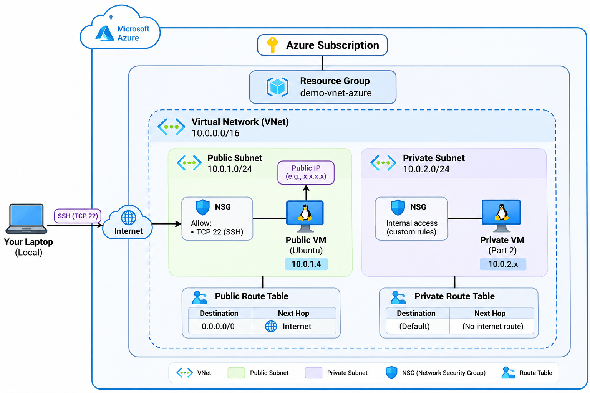

<h1>🚀 Spring Boot Microservices Deployment on Azure AKS</h1>

<h3>CI/CD Automation Using Jenkins Pipeline, Docker, Azure Container Registry and Helm Charts</h3>

  
  
  
  
  
  

  <b>Build | Test | Containerize | Push | Deploy | Verify</b>

<h2>📌 1. Project Overview</h2>

This project demonstrates an end-to-end DevOps CI/CD implementation for deploying a Spring Boot Microservices application into Microsoft Azure Kubernetes Service (AKS) using Jenkins Pipeline and Helm Charts.

The main objective is to automate the complete application deployment lifecycle using Jenkins, Docker, Azure Container Registry (ACR), Kubernetes and Helm.

<h3>CI/CD Pipeline Responsibilities</h3>

<ol>
<li>Checkout application source code from GitHub.</li>
<li>Build the Spring Boot application using Maven.</li>
<li>Generate the executable JAR file.</li>
<li>Build the Docker image.</li>
<li>Push the Docker image into Azure Container Registry (ACR).</li>
<li>Deploy the application into Azure Kubernetes Service (AKS) using Helm.</li>
<li>Expose the application through a Kubernetes LoadBalancer service.</li>
<li>Verify the deployment and access the application through a web browser.</li>
</ol>

<h2>🏗️ 2. Project Architecture</h2>

<h3>2.1 Azure Virtual Network Architecture</h3>

The following diagram illustrates the Azure networking architecture used in the lab environment, including the Virtual Network, public and private subnets, Network Security Groups and Route Tables.

<h3>2.2 CI/CD Deployment Architecture</h3>

<pre>
                  Developer
                      |
                      | Git Push
                      v
              GitHub Repository
                      |
                      | Jenkins Pipeline
                      v
             Jenkins Server (Azure VM)
                      |
              +-------+-------+
              |               |
              v               v
          Maven Build     Docker Build
              |               |
              v               v
        Spring Boot JAR   Docker Image
                              |
                              v
                 Azure Container Registry
                            (ACR)
                              |
                              | Pull Image
                              v
                 Azure Kubernetes Service
                            (AKS)
                              |
                   Namespace: helm-deployment
                              |
                              v
                       Helm Deployment
                              |
                              v
                      Kubernetes Pod
                              |
                              v
                    LoadBalancer Service
                              |
                              v
                       External IP
                              |
                              v
                         Web Browser
</pre>

<h3>2.3 Technology Stack</h3>

<table border="1" cellpadding="8" cellspacing="0" width="100%">
<tr>
<th>Component</th>
<th>Technology</th>
<th>Purpose</th>
</tr>
<tr><td>Cloud Platform</td><td>Microsoft Azure</td><td>Cloud infrastructure</td></tr>
<tr><td>Container Orchestration</td><td>Azure Kubernetes Service</td><td>Container management</td></tr>
<tr><td>Container Registry</td><td>Azure Container Registry</td><td>Docker image storage</td></tr>
<tr><td>CI/CD</td><td>Jenkins</td><td>Pipeline automation</td></tr>
<tr><td>Containerization</td><td>Docker</td><td>Application containerization</td></tr>
<tr><td>Deployment Management</td><td>Helm</td><td>Kubernetes deployment management</td></tr>
<tr><td>Build Automation</td><td>Apache Maven</td><td>Java application build</td></tr>
<tr><td>Programming Language</td><td>Java</td><td>Application development</td></tr>
<tr><td>Framework</td><td>Spring Boot</td><td>Microservices development</td></tr>
<tr><td>Source Control</td><td>Git / GitHub</td><td>Version control</td></tr>
<tr><td>Kubernetes CLI</td><td>kubectl</td><td>Cluster management</td></tr>
<tr><td>Cloud Management</td><td>Azure CLI</td><td>Azure resource management</td></tr>
</table>

<h2>📋 3. Prerequisites</h2>

<h3>Azure Cloud Resources</h3>

<ul>
<li>Azure Subscription</li>
<li>Azure Resource Group</li>
<li>Azure Kubernetes Service (AKS)</li>
<li>Azure Container Registry (ACR)</li>
<li>Ubuntu Linux Virtual Machine for Jenkins</li>
</ul>

<h3>Jenkins Server Requirements</h3>

<table border="1" cellpadding="8" cellspacing="0" width="100%">
<tr><th>Tool</th><th>Version Used in Lab</th><th>Purpose</th></tr>
<tr><td>Operating System</td><td>Ubuntu 24.04</td><td>Jenkins server</td></tr>
<tr><td>Java</td><td>OpenJDK 21</td><td>Java runtime</td></tr>
<tr><td>Apache Maven</td><td>3.8.7</td><td>Application build</td></tr>
<tr><td>Docker</td><td>29.1.3</td><td>Container image creation</td></tr>
<tr><td>Azure CLI</td><td>2.93.0</td><td>Azure management</td></tr>
<tr><td>kubectl</td><td>1.37.2</td><td>Kubernetes management</td></tr>
<tr><td>Helm</td><td>Installed</td><td>Kubernetes deployment</td></tr>
</table>

<h3>Required Jenkins Plugins</h3>

<ul>
<li>Pipeline</li>
<li>Docker Pipeline</li>
<li>Git</li>
<li>Credentials Binding</li>
</ul>

<h2>☁️ 4. Azure Infrastructure Setup</h2>

<h3>4.1 Azure Resources</h3>

<table border="1" cellpadding="8" cellspacing="0" width="100%">
<tr><th>Resource</th><th>Name</th><th>Region</th></tr>
<tr><td>Resource Group</td><td>aks-rg</td><td>North Europe</td></tr>
<tr><td>AKS Cluster</td><td>aks-cluster</td><td>North Europe</td></tr>
<tr><td>Container Registry</td><td>myacrrepo531</td><td>North Europe</td></tr>
<tr><td>Kubernetes Namespace</td><td>helm-deployment</td><td>AKS</td></tr>
</table>

<h3>4.2 Authenticate to Azure from Jenkins VM</h3>

Log in to the Jenkins virtual machine and switch to the Jenkins user.

<pre><code>sudo su - jenkins</code></pre>

Authenticate to Azure:

<pre><code>az login</code></pre>

For a headless server, use device-code authentication if prompted.

<h3>4.3 Create Azure Infrastructure Using Shell Script</h3>

Create the infrastructure provisioning script:

<pre><code>vi create-aks.sh</code></pre>

Execute the script:

<pre><code>chmod +x create-aks.sh

./create-aks.sh</code></pre>

The script provisions:

<ul>
<li>Resource Group</li>
<li>AKS Cluster</li>
<li>Azure Container Registry</li>
<li>AKS-to-ACR image pull permission</li>
<li>Kubernetes namespace</li>
</ul>

<b>Note:</b> The infrastructure script should be added to the repository separately. Review the script and Azure costs before executing it.

<h3>4.4 Verify AKS Cluster</h3>

Check Kubernetes worker nodes:

<pre><code>kubectl get nodes</code></pre>

Check cluster information:

<pre><code>kubectl cluster-info</code></pre>

Check Kubernetes namespaces:

<pre><code>kubectl get namespaces</code></pre>

<h2>📦 5. Create Helm Chart</h2>

Navigate to the root directory of the Spring Boot application repository.

Create a Helm chart:

<pre><code>helm create mychart</code></pre>

View the generated directory structure:

<pre><code>tree mychart</code></pre>

<h3>Helm Chart Structure</h3>

<pre>
mychart/
│
├── Chart.yaml
├── values.yaml
├── charts/
│
└── templates/
    ├── deployment.yaml
    ├── service.yaml
    ├── ingress.yaml
    ├── hpa.yaml
    ├── serviceaccount.yaml
    └── tests/
</pre>

<h3>5.1 Configure Docker Image Repository</h3>

Open the values.yaml file:

<pre><code>vi mychart/values.yaml</code></pre>

Configure the Azure Container Registry image repository:

<pre><code>image:
  repository: myacrrepo531.azurecr.io/myacrrepo531
  tag: ""</code></pre>

<h3>5.2 Configure Container Port</h3>

Open the deployment template:

<pre><code>vi mychart/templates/deployment.yaml</code></pre>

Configure the Spring Boot container port:

<pre><code>ports:
  - name: http
    containerPort: 8080
    protocol: TCP</code></pre>

<h3>5.3 Configure Kubernetes Service</h3>

Configure the service in values.yaml:

<pre><code>service:
  type: LoadBalancer
  port: 80
  targetPort: 8080</code></pre>

Ensure that the service template uses these values and that the application listens on port 8080.

Commit and push the updated Helm chart into GitHub.

<h2>🔐 6. Jenkins Configuration</h2>

<h3>Step 1: Configure Maven in Jenkins</h3>

Navigate to:

<b>Manage Jenkins → Tools → Maven installations</b>

Add Maven installation:

<pre><code>Name: Maven3</code></pre>

Save the configuration.

<h3>Step 2: Configure Azure Container Registry Credentials</h3>

Navigate to:

<b>Azure Portal → Container Registry → Settings → Access keys</b>

Retrieve the registry username and password if using the registry-admin credential method.

Navigate to:

<b>Jenkins → Manage Jenkins → Credentials</b>

Create a new credential with the following details:

<table border="1" cellpadding="8" cellspacing="0" width="100%">
<tr><th>Field</th><th>Value</th></tr>
<tr><td>Kind</td><td>Username with password</td></tr>
<tr><td>Username</td><td>ACR username</td></tr>
<tr><td>Password</td><td>ACR password</td></tr>
<tr><td>ID</td><td>ACR</td></tr>
<tr><td>Description</td><td>Azure Container Registry Credentials</td></tr>
</table>

<b>Security recommendation:</b> Never hard-code passwords in Jenkinsfiles or GitHub repositories. For production environments, prefer managed identity or a service principal with minimum required permissions.

<h3>Step 3: Create Jenkins Pipeline Job</h3>

<ol>
<li>Open Jenkins Dashboard.</li>
<li>Click New Item.</li>
<li>Enter job name: <b>myHelmDeployJob</b>.</li>
<li>Select Pipeline.</li>
<li>Click OK.</li>
<li>Configure the pipeline script.</li>
<li>Save the configuration.</li>
</ol>

<h2>⚙️ 7. Jenkins Pipeline Script</h2>

Create a file named <b>Jenkinsfile</b> in the root directory of the application repository.

<pre><code>pipeline {
    agent any

    tools {
        maven 'Maven3'
    }

    environment {
        registryName       = 'myacrrepo531'
        registryCredential = 'ACR'
        registryUrl        = 'myacrrepo531.azurecr.io'
        imageRepository    = 'myacrrepo531'
    }

    stages {

        stage('Checkout') {
            steps {
                git branch: 'master',
                    url: '&lt;YOUR_GITHUB_REPOSITORY_URL&gt;'
            }
        }

        stage('Build Jar') {
            steps {
                sh 'mvn clean install'
            }
        }

        stage('Build Docker Image') {
            steps {
                script {
                    dockerImage = docker.build(
                        "${registryUrl}/${imageRepository}:${BUILD_NUMBER}"
                    )
                }
            }
        }

        stage('Upload Image to ACR') {
            steps {
                script {
                    docker.withRegistry(
                        "https://${registryUrl}",
                        registryCredential
                    ) {
                        dockerImage.push()
                    }
                }
            }
        }

        stage('Helm Deploy') {
            steps {
                script {
                    sh """
                        helm upgrade first ./mychart \
                          --install \
                          --namespace helm-deployment \
                          --create-namespace \
                          --set image.repository=${registryUrl}/${imageRepository} \
                          --set image.tag=${BUILD_NUMBER}
                    """
                }
            }
        }
    }

    post {
        success {
            echo 'Application deployed successfully into AKS!'
        }

        failure {
            echo 'Pipeline execution failed. Check Jenkins console output.'
        }
    }
}</code></pre>

<h3>Pipeline Stages Explained</h3>

<table border="1" cellpadding="8" cellspacing="0" width="100%">
<tr><th>Stage</th><th>Description</th></tr>
<tr><td>Checkout</td><td>Downloads application source code from GitHub.</td></tr>
<tr><td>Build Jar</td><td>Builds the Spring Boot application using Maven.</td></tr>
<tr><td>Build Docker Image</td><td>Creates a Docker image using the Dockerfile.</td></tr>
<tr><td>Upload Image to ACR</td><td>Pushes the Docker image into Azure Container Registry.</td></tr>
<tr><td>Helm Deploy</td><td>Deploys or upgrades the application in AKS using Helm.</td></tr>
</table>

<b>Important:</b> The Jenkins agent must have valid AKS authentication and the required Kubernetes permissions before executing the Helm deployment stage.

<h2>▶️ 8. Execute Jenkins Pipeline</h2>

<ol>
<li>Open Jenkins Dashboard.</li>
<li>Select <b>myHelmDeployJob</b>.</li>
<li>Click <b>Build Now</b>.</li>
<li>Open the running build.</li>
<li>Select Console Output.</li>
<li>Monitor the execution of all pipeline stages.</li>
</ol>

<h3>Expected Pipeline Execution</h3>

<pre>
Checkout
   |
   v
Build Jar
   |
   v
Build Docker Image
   |
   v
Upload Image to ACR
   |
   v
Helm Deploy
   |
   v
SUCCESS
</pre>

Each Jenkins build creates a Docker image with a unique build number.

Example:

<pre><code>myacrrepo531.azurecr.io/myacrrepo531:9</code></pre>

<h2>🔎 9. Verify Deployment in AKS</h2>

<h3>9.1 Verify Helm Release</h3>

<pre><code>helm ls -n helm-deployment</code></pre>

<h3>9.2 Verify Kubernetes Pods</h3>

<pre><code>kubectl get pods -n helm-deployment</code></pre>

<h3>9.3 Verify Kubernetes Deployments</h3>

<pre><code>kubectl get deployments -n helm-deployment</code></pre>

<h3>9.4 Verify Kubernetes Services</h3>

<pre><code>kubectl get services -n helm-deployment</code></pre>

<h3>9.5 Verify Application Logs</h3>

<pre><code>kubectl logs deployment/&lt;DEPLOYMENT_NAME&gt; -n helm-deployment</code></pre>

<h2>🌐 10. Access Spring Boot Application</h2>

Once the Kubernetes LoadBalancer service receives an external IP address, retrieve it using:

<pre><code>kubectl get svc -n helm-deployment</code></pre>

Example output from the lab environment:

<pre>
NAME          TYPE           CLUSTER-IP      EXTERNAL-IP
first-mychart LoadBalancer   10.0.157.225    4.209.111.230
</pre>

Open a web browser and enter:

<pre><code>http://&lt;EXTERNAL-IP&gt;</code></pre>

The Spring Boot application should now be accessible through the external LoadBalancer IP, provided the application and service are configured correctly.

<h2>📸 11. Project Implementation Screenshots</h2>

The following screenshots can be added to demonstrate the actual implementation and successful deployment.

<h3>Azure Infrastructure</h3>

Azure Resource Group, Virtual Network, AKS Cluster and ACR configuration.

<h3>Jenkins Dashboard</h3>

Jenkins server and configured pipeline job.

<h3>Jenkins Pipeline Execution</h3>

Successful Jenkins pipeline execution.

<h3>Azure Container Registry</h3>

Docker images uploaded into Azure Container Registry.

<h3>AKS Kubernetes Workloads</h3>

Application deployment and Kubernetes pod status.

<h3>AKS Services and LoadBalancer</h3>

Kubernetes service and external IP address.

<h3>Application Running in Browser</h3>

Successfully deployed Spring Boot application.

<i>Note: Add your actual screenshots using the filenames above. Remove any image section for which you do not have a screenshot. Mask sensitive information before publishing.</i>

<h2>🛠️ 12. Troubleshooting</h2>

<table border="1" cellpadding="8" cellspacing="0" width="100%">
<tr><th>Problem</th><th>Possible Solution</th></tr>
<tr><td>Maven command not found</td><td>Verify Maven installation and Jenkins tool configuration.</td></tr>
<tr><td>Docker permission denied</td><td>Verify Docker service and Jenkins user permissions.</td></tr>
<tr><td>ACR authentication failed</td><td>Check Jenkins credentials and registry URL.</td></tr>
<tr><td>ImagePullBackOff</td><td>Verify image repository, tag and AKS pull permissions.</td></tr>
<tr><td>Helm deployment failed</td><td>Check Helm chart configuration and AKS connectivity.</td></tr>
<tr><td>kubectl authentication error</td><td>Verify kubeconfig and AKS credentials.</td></tr>
<tr><td>Pod not ready</td><td>Check application logs, container port and Kubernetes events.</td></tr>
<tr><td>External IP pending</td><td>Check LoadBalancer provisioning and Azure networking.</td></tr>
</table>

<h3>Useful Troubleshooting Commands</h3>

<pre><code># List Kubernetes resources
kubectl get all -n helm-deployment

# Check pods
kubectl get pods -n helm-deployment

# Describe pod
kubectl describe pod &lt;POD_NAME&gt; -n helm-deployment

# Check application logs
kubectl logs &lt;POD_NAME&gt; -n helm-deployment

# Check Helm release
helm status first -n helm-deployment

# Check services
kubectl get svc -n helm-deployment</code></pre>

<h2>🧹 13. Clean Up Azure Resources</h2>

To avoid unnecessary Azure charges, delete the lab resources when they are no longer required.

Execute the following command:

<pre><code>az group delete \
  --name &lt;RESOURCE_GROUP_NAME&gt; \
  --yes \
  --no-wait</code></pre>

<b>Warning:</b> This command permanently deletes the resource group and all resources contained within it. Verify that no required resources are stored in the resource group before executing.

<h2>🎯 14. Learning Outcomes</h2>

Through this project, I gained practical experience in:

<ul>
<li>Building CI/CD pipelines using Jenkins.</li>
<li>Automating Java application builds using Maven.</li>
<li>Containerizing Spring Boot applications using Docker.</li>
<li>Managing Docker images using Azure Container Registry.</li>
<li>Deploying containerized applications into Azure Kubernetes Service.</li>
<li>Creating and managing Helm Charts.</li>
<li>Automating Kubernetes deployments using Jenkins.</li>
<li>Managing Kubernetes namespaces, pods, deployments and services.</li>
<li>Exposing applications through Azure LoadBalancer.</li>
<li>Troubleshooting cloud-native application deployments.</li>
</ul>

<h2>📚 15. References</h2>

<ul>
<li><a href="https://azure.microsoft.com/">Microsoft Azure</a></li>
<li><a href="https://learn.microsoft.com/en-us/azure/aks/">Azure Kubernetes Service</a></li>
<li><a href="https://learn.microsoft.com/en-us/azure/container-registry/">Azure Container Registry</a></li>
<li><a href="https://learn.microsoft.com/en-us/azure/aks/cluster-container-registry-integration">AKS and ACR Integration</a></li>
<li><a href="https://www.jenkins.io/doc/">Jenkins Documentation</a></li>
<li><a href="https://docs.docker.com/">Docker Documentation</a></li>
<li><a href="https://kubernetes.io/docs/">Kubernetes Documentation</a></li>
<li><a href="https://helm.sh/docs/">Helm Documentation</a></li>
<li><a href="https://docs.spring.io/spring-boot/index.html">Spring Boot Documentation</a></li>
</ul>

<h2>👨‍💻 16. Project Information</h2>

<table border="1" cellpadding="8" cellspacing="0" width="100%">
<tr><td><b>Project</b></td><td>Spring Boot Microservices Deployment on Azure AKS</td></tr>
<tr><td><b>Cloud Platform</b></td><td>Microsoft Azure</td></tr>
<tr><td><b>CI/CD Tool</b></td><td>Jenkins</td></tr>
<tr><td><b>Containerization</b></td><td>Docker</td></tr>
<tr><td><b>Container Registry</b></td><td>Azure Container Registry</td></tr>
<tr><td><b>Orchestration</b></td><td>Azure Kubernetes Service</td></tr>
<tr><td><b>Deployment</b></td><td>Helm Charts</td></tr>
<tr><td><b>Build Tool</b></td><td>Apache Maven</td></tr>
<tr><td><b>Implementation Date</b></td><td>November 2026</td></tr>
<tr><td><b>Author</b></td><td>Sasith Wickramasinghe</td></tr>
</table>

<h3>🚀 Learning DevOps | Cloud Engineering | Kubernetes | CI/CD Automation</h3>

<b>If you find this project useful, please give the repository a ⭐ Star!</b>

